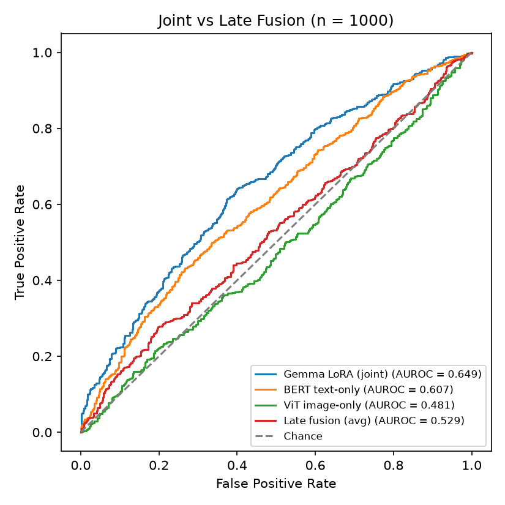

# Multimodal hateful meme detection

Does reading a meme's image and caption together beat combining two separate models? This project
answers that with a controlled comparison on the Hateful Memes dataset: **joint fusion** with a
LoRA fine-tuned Gemma 4 E4B against **late fusion** of a frozen BERT and a frozen ViT.

Built for the Intelligent Information Systems course at FCSE, Skopje, by a team of two.
Full write-up: [markoivanovski.com/projects/hateful-meme-detection](https://markoivanovski.com/projects/hateful-meme-detection)

## Results

All models were trained on the same 500 memes and tested on the same 1,000 held-out memes (490
hateful, 510 not). Confidence intervals are bootstrapped.

| Model | Fusion | AUROC | 95% CI |
| --- | --- | --- | --- |
| **Gemma 4 E4B + LoRA** | joint | **0.649** | 0.615 to 0.683 |
| BERT, text only | none | 0.607 | 0.573 to 0.643 |
| ViT, image only | none | 0.481 | 0.445 to 0.516 |
| BERT + ViT, averaged | late | 0.529 | 0.493 to 0.564 |



Only the jointly fine-tuned model separates hateful memes clearly better than chance. Averaging the
text and image models lands below the text model alone, because the image model is close to random
and drags the average down. The dataset was built with confounders that punish exactly this kind of
naive combination.

## Approach

**Data.** [`limjiayi/hateful_memes_expanded`](https://huggingface.co/datasets/limjiayi/hateful_memes_expanded),
sampled from the challenge's own disjoint splits so nothing leaks between them: 500 train, 200
validation, 1,000 test. `Data/prepare_data.py` builds the frozen sets.

**Joint fusion.** `google/gemma-4-E4B-it` loaded in 4-bit, with LoRA adapters (r 16, alpha 32) on
the language projections, the vision tower and the vision-to-text connector. It is trained to answer
Yes or No, and `P(hateful)` is the softmax over the Yes and No logits at the answer position. The
checkpoint with the best validation AUROC is kept, not the last epoch.

**Late fusion.** Frozen `bert-base-uncased` and `google/vit-base-patch16-224-in21k` each produce a
768-dimensional vector. A separate MLP head is trained on each, and the late-fusion score is the
plain average of the two probabilities.

## What we learnt

- LoRA on the language side alone wasn't enough to make Gemma use the image. The adapters had to
  reach the vision tower and its connector too.
- Pick the checkpoint by validation AUROC. One run fell from 0.639 at epoch four to 0.487 at epoch five.
- On a test set this hard, the F1-maximising threshold drops so low that accuracy and F1 stop
  meaning much, so AUROC is the metric we report.

## Repository

```text
Data/prepare_data.py                    builds the frozen train, validation and test sets
Notebooks/single_multimodal_model.ipynb Gemma 4 E4B joint fusion with LoRA
Notebooks/late_fusion_notebook.ipynb    BERT + ViT late fusion
Notebooks/compare_fusion.ipynb          AUROC, bootstrap intervals and the combined ROC plot
Results/                                test-set predictions and ROC plots
Papers/                                 the literature the project draws on
```

## Running it

The notebooks run on Google Colab with a single T4 GPU and read the data from Google Drive.

1. Build the data: `python Data/prepare_data.py --out "/content/drive/MyDrive/IIS Project/Data"`.
2. Run `single_multimodal_model.ipynb` and `late_fusion_notebook.ipynb`. Each writes its test-set
   predictions to `Results/`. Gemma needs a Hugging Face token with access to the model.
3. Run `compare_fusion.ipynb` to reproduce the table and the plot above.

## Next steps

- Swap the frozen ViT for CLIP and learn the fusion weights instead of a fixed average.
- Regularise the classification heads and train on more than 500 memes.
- Evaluate the confounder memes on their own once a dataset version labels them.
